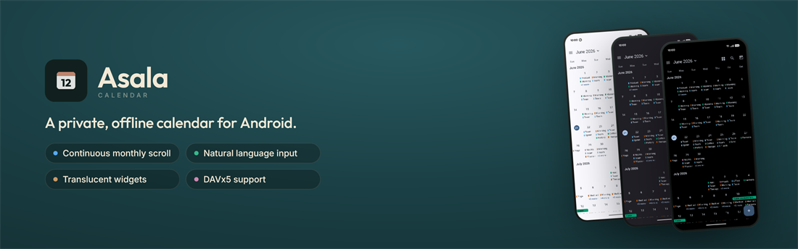
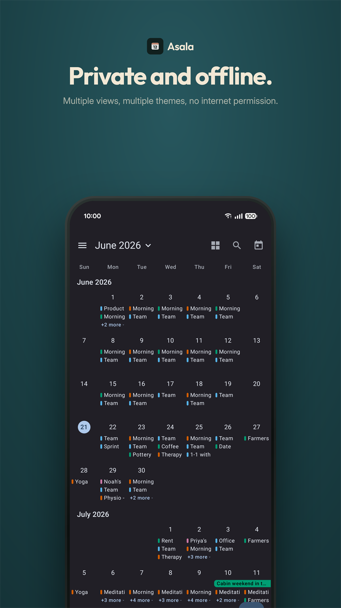
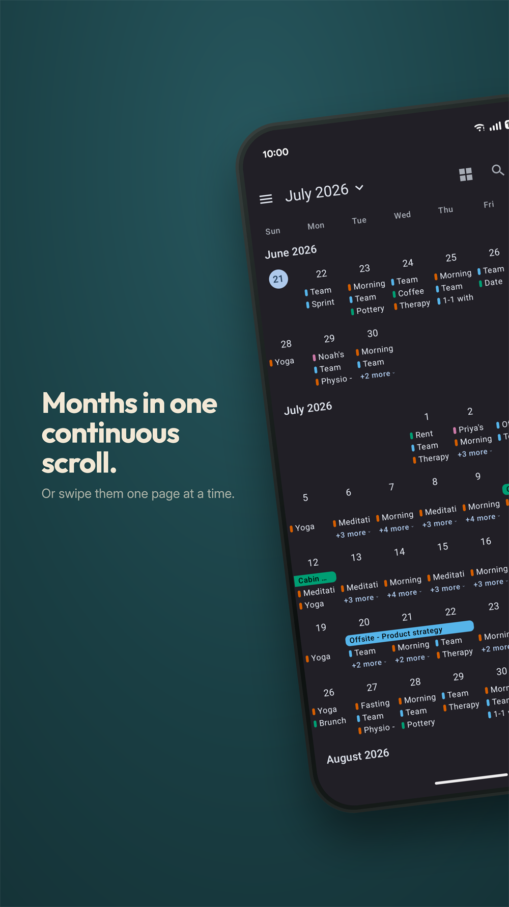
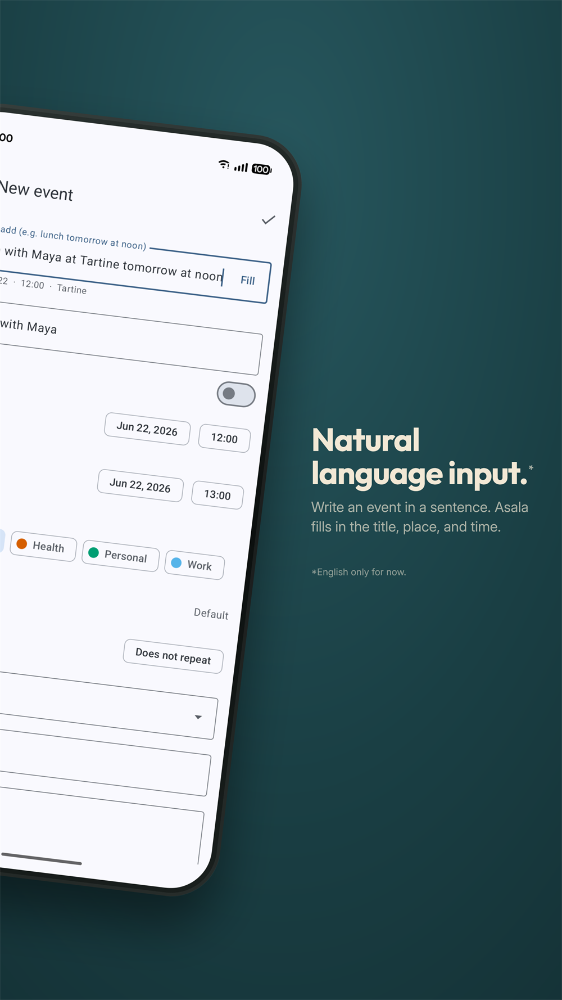
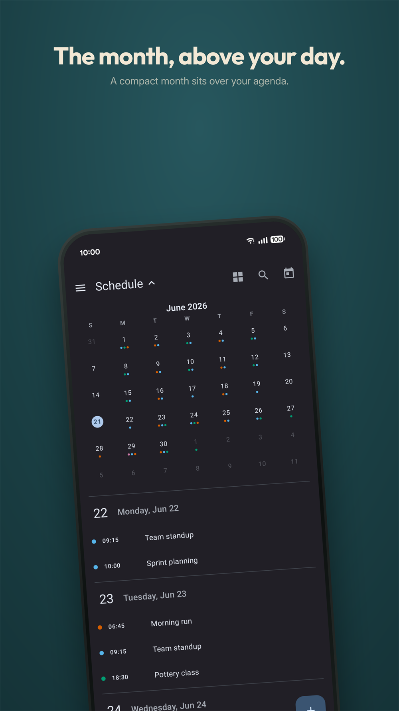
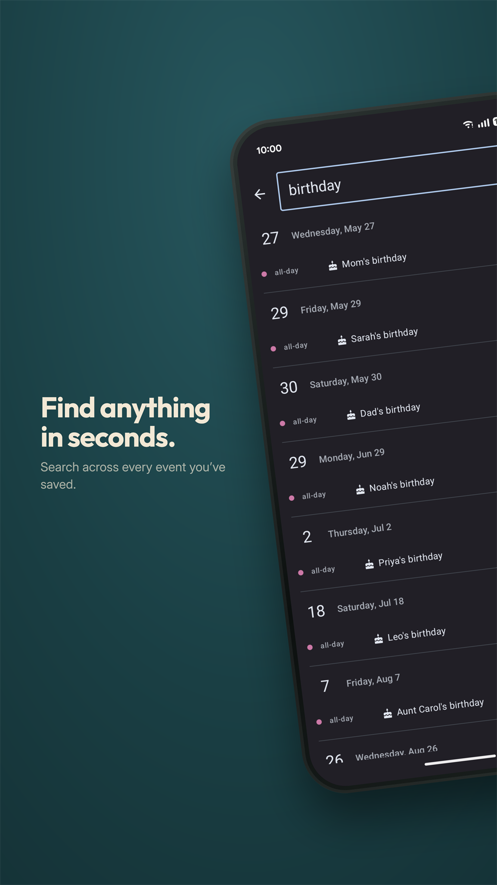
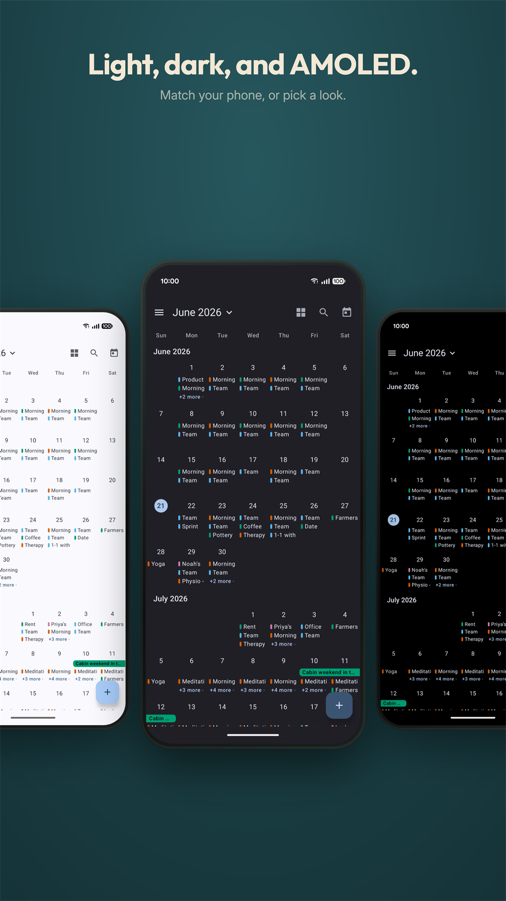

# Asala Calendar

  

A private, offline-first calendar for Android.

  
  

  

Asala uses Android's system calendar and has no internet permission. Events may still sync through accounts configured on your device.

## Screenshots

<table>
  <tr>
    <td></td>
    <td></td>
    <td></td>
  </tr>
  <tr>
    <td></td>
    <td></td>
    <td></td>
  </tr>
</table>

## Features

- Year, month, week, 3-day, day, and schedule views.
- Continuous or paged month view.
- Create, edit, duplicate, delete, and repeat events.
- Natural-language event entry.
- Search by title, location, or notes.
- Multiple reminders, snooze, and separate defaults for timed and all-day events.
- Drag events to reschedule them.
- Birthdays and anniversaries from your contacts.
- Local, synced, and CalDAV calendars through Android's calendar provider.
- Per-event colors, dynamic color, and light, dark, or AMOLED themes.
- Agenda and month home-screen widgets.
- Optional focus mode, ISO week numbers, and adjustable font size.

## Install

- [GitHub Releases](https://github.com/Arishawke/asala-calendar/releases) for the signed APK
- [Obtainium](https://apps.obtainium.imranr.dev/redirect.html?r=obtainium://add/https://github.com/Arishawke/asala-calendar) for updates from GitHub Releases

Asala is a personal project built with substantial AI assistance.

## License

[GPL v3](LICENSE). © 2026 Arishawke.
